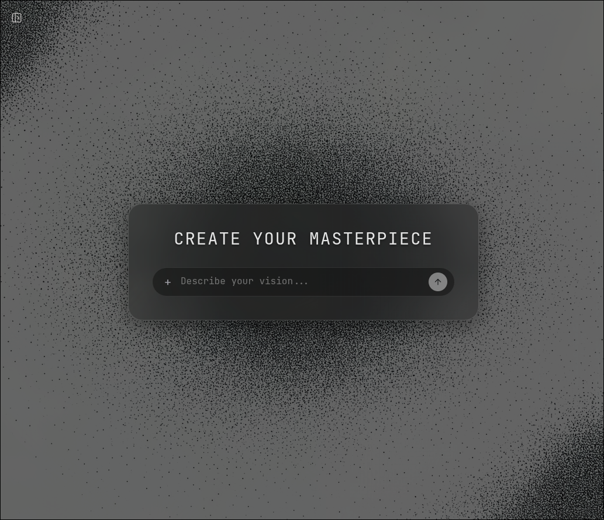
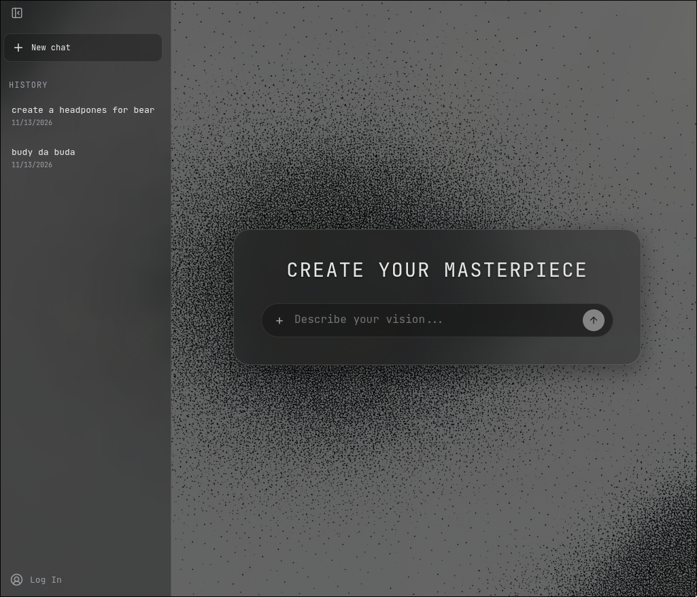

# Text-to-Masterpiece

**Text-to-Masterpiece (T2M)** — веб-приложение для генерации ваших шедевров по текстовому описанию .. 





.. с поддержкой на v 0.1.0-beta:
- пользовательских аккаунтов 
- гостевых сессий 
- истории генераций, что сохраняются при регистрации/входе в акк

Проект включает React-фронтенд, REST API на FastAPI, PostgreSQL, приватное объектное хранилище и интеграцию с Cloudflare Workers AI.

**[Открыть приложение](https://text-to-masterpiece.sanek-evteev2002.workers.dev)** · [Исходный код](https://github.com/Sa4eNecHinS/Text-to-Masterpiece)

**Статус:** beta — основная функциональность доступна, проект продолжает развиваться.

## Возможности

- **Text-to-image:** генерация изображений через FLUX.1-schnell и FLUX-2-klein-4b.
- **Гостевой режим:** использование сервиса без обязательной регистрации.
- **Авторизация:** регистрация, вход и управление сессиями с помощью JWT и HttpOnly cookies.
- **Чаты и история:** сохранение запросов, изображений и продолжение существующих чатов.
- **Перенос истории:** сохранение гостевых генераций при регистрации или входе.
- **Приватное хранение:** изображения размещаются в Backblaze B2 и выдаются через API после проверки владельца.
- **Контроль ресурсов:** ограничения частоты запросов, одновременных генераций и дневного бюджета AI.

## Архитектура

```text
Browser (React + TypeScript)
           |
           | HTTPS
           v
Cloudflare Workers
  |               |
  | Static Assets | Reverse Proxy (/api/*)
  |               |
  v               v
Frontend       Render (FastAPI)
                  |
           +------+--------+------------+
           |               |            |
           v               v            v
    Neon PostgreSQL   Backblaze B2   Workers AI
      Users/Chats        Images         FLUX
```

**Обработка генерации:**

1. Пользователь отправляет текстовый запрос через React.
2. Cloudflare Worker проксирует API-запрос на FastAPI.
3. Backend проверяет идентичность пользователя, лимиты и доступность слотов генерации.
4. Cloudflare Workers AI генерирует изображение.
5. Backend сохраняет изображение в B2, а метаданные — в PostgreSQL.
6. Клиент получает идентификатор генерации и загружает изображение через защищённый API.

## Технологии

| Компонент | Технологии |
|---|---|
| Frontend | React, TypeScript, Vite |
| Backend | Python 3.14, FastAPI, Pydantic |
| Database | PostgreSQL, SQLAlchemy 2, asyncpg, Alembic |
| Authentication | JWT, HttpOnly cookies, bcrypt |
| AI | Cloudflare Workers AI, FLUX |
| Object Storage | Backblaze B2, boto3 (S3 API) |
| Reverse Proxy | Cloudflare Workers / Nginx (локально) |
| Deployment | Cloudflare Workers, Render, Neon |
| Infrastructure | Docker, Docker Compose, GitHub |

## Технические решения

### Конкурентность и ограничения

Генерация изображений — ресурсоёмкая операция, поэтому backend реализует несколько уровней защиты:

- **Token Bucket:** rate limiting с хранением состояния в PostgreSQL.
- **PostgreSQL advisory locks:** не более одной активной генерации на пользователя и глобальное ограничение параллельных операций.
- **Daily AI budget:** атомарное резервирование оценочной стоимости генераций в Neurons.
- **Timeouts:** ограничение времени ожидания внешнего AI-провайдера.

### Безопасность данных

- Разграничение доступа к чатам и изображениям по владельцу.
- Приватный B2 bucket без прямого публичного доступа к объектам.
- HttpOnly cookies и проверка Origin для защиты browser API.
- Серверное хранение ключей Cloudflare AI и B2.
- Запрет HTTP-кэширования приватных API-ответов.

## Структура репозитория

```text
Text-to-Masterpiece/
├── app/
│   ├── backend/
│   │   ├── api/              # API endpoints
│   │   ├── core/             # Config, security, CSRF
│   │   ├── database/         # ORM, queries, locking
│   │   ├── services/         # AI and object storage
│   │   └── alembic/          # Database migrations
│   └── frontend/
│       ├── src/              # React application
│       ├── worker/           # Cloudflare API proxy
│       └── wrangler.jsonc    # Worker configuration
├── docs/                     # Technical notes
├── compose.local.yaml        # Local environment
├── docker-compose.yml        # Container deployment
└── README.md
```

## Локальный запуск

### Требования

- Docker и Docker Compose
- Доступ к Cloudflare Workers AI
- Backblaze B2 bucket и Application Key

### Полный стек через Docker Compose

Из корня репозитория создайте `.env.docker` с параметром `TTM_DB_PASSWORD` и `.env.backend.docker-local` на основе `app/backend/.env.example`.

В backend environment необходимо настроить ключи Cloudflare AI, B2, JWT secret и подходящие параметры cookies и CORS для локального адреса.

Затем выполните:

```bash
docker compose \
  -f compose.local.yaml \
  --env-file .env.docker \
  up -d --build
```

Приложение будет доступно по адресу `http://127.0.0.1:3000`.

### Frontend отдельно

```bash
cd app/frontend
npm ci
npm run dev
```

Vite запускает локальный dev-сервер. Для полноценной работы API необходим запущенный backend.

### Проверка frontend

```bash
cd app/frontend

npm test
npm run lint
npm run build
```

## Развёртывание

Production использует независимые сервисы:

- **Cloudflare Workers:** React Static Assets и API reverse proxy.
- **Render:** Docker-контейнер FastAPI.
- **Neon:** PostgreSQL с миграциями Alembic.
- **Backblaze B2:** приватное хранилище изображений.

Изменения frontend в `main` автоматически собираются и публикуются через Cloudflare Builds.

Секреты backend задаются через переменные окружения и не должны храниться в Git.

### Экспериментальное пробуждение Render

При readiness-ответе `/api/Text-to-Masterpiece/models` с `502` и заголовком
`x-render-routing: no-deploy` frontend однократно за цикл добавляет скрытый iframe
на публичный Render `/Text-to-Masterpiece/models`. Обычный `502` его не запускает.
Iframe использует пустой sandbox, `no-referrer` и `credentialless`; токены и
параметры сессии не передаются. В браузерах без поддержки `credentialless`
навигация пропускается, чтобы не отправить cookies Render.

Это обход проблемы маршрутизации, а не гарантированное исправление Render.
Готовность определяется только корректным JSON-каталогом через Worker, независимо
от загрузки iframe. CSP / политика встраивания могут заблокировать навигацию;
обычный retry с backoff, jitter и бюджетом 120 секунд продолжится. Iframe удаляется
после успеха, ошибки, исчерпания бюджета или размонтирования AuthProvider.
Автоматических повторов генерации и постоянного ping нет.

После отдельно согласованной публикации frontend проверить в production:

1. Дождаться сна Render, открыть приложение с DevTools Network и подтвердить
   `502` с `x-render-routing: no-deploy` на Worker `/models`. Worker должен сохранять
   этот заголовок; без него iframe намеренно не создаётся.
2. В поддерживающем `credentialless` браузере проверить единственную навигацию iframe
   на Render без Cookie / Authorization / Referer. Если задан CSP frontend, для этого
   эксперимента потребуется разрешить `https://ttm-backend-du5g.onrender.com` в `frame-src`.
   Не ослаблять sandbox или backend-политику встраивания ради обхода блокировки.
3. Проверить, что Create и ввод промпта доступны, после валидного Worker JSON
   восстанавливаются сессия, модели и история, iframe исчезает, а `/generate` не отправляется.
4. Проверить fallback при блокировке iframe и в неподдерживаемом браузере, удаление
   iframe при уходе из приложения и по истечении бюджета, отсутствие постоянных запросов.

## Документация

- [Внутреннее устройство backend](app/backend/docs/backend-internals.md)
- [Хранение изображений в B2](app/backend/B2_STORAGE.md)
- [Пример переменных окружения](app/backend/.env.example)

## Статус проекта

T2M находится на этапе публичного beta-тестирования. Основные пользовательские сценарии реализованы, однако проверки безопасности, нагрузки и устойчивости production-инфраструктуры продолжаются.

Проект разработан как практическая работа с backend-архитектурой, асинхронным Python, PostgreSQL, внешними API и облачной инфраструктурой.
